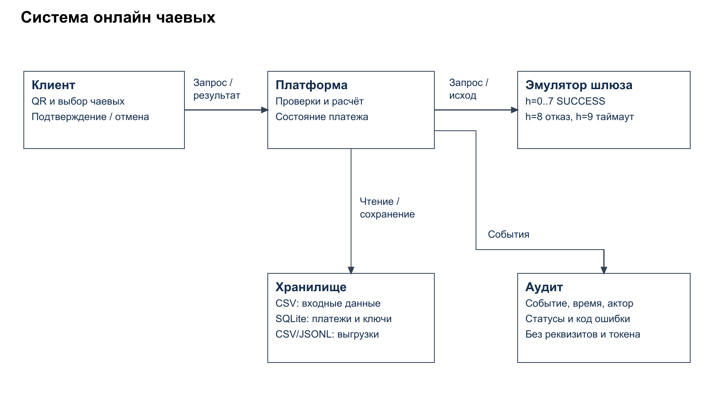
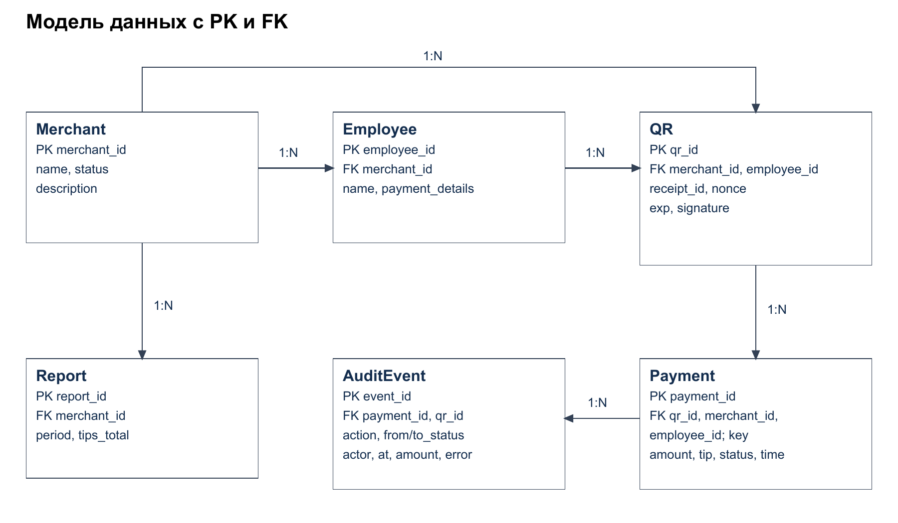
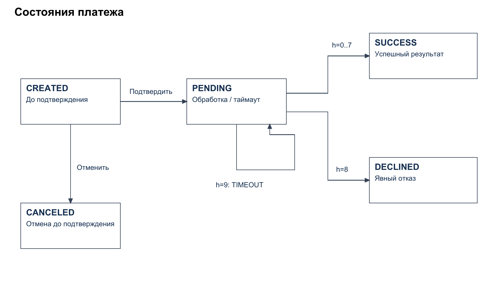

# Приложение к презентации — кейс 3 «Онлайн-чаевые»

## Назначение и статус

Приложение объединяет модель сервиса, правила, тестовые сценарии и сведения о подготовке решения для сети «Вкус-Сервис». Посетитель получает QR на чеке, выбирает чаевые и подтверждает учебный платёж. Реальных списаний и выплат нет.

Подготовлены Markdown-документы, платёжный CLI-прототип, тесты и контракт OpenAPI. Исходные CSV и Word сохранены. В output находятся презентация на 8 слайдов, приложение PDF на 14 страниц и три диаграммы в draw.io/PNG. Фактические результаты: 15 проверок пройдены, 2 фиксируют противоречия исходных ожиданий. Матрицу вклада пользователь заполнит самостоятельно; список его действий — 01_Чек-лист_для_самостоятельного_заполнения.md.

Исходный набор: 20 мерчантов, 60 сотрудников, 100 платежей и 100 QR. Исторические данные датированы ноябрём 2025 года. Ссылки на отсутствующие 08_ER.md и 10_tests.md заменены ссылками на фактические 08_errors.md и 03_тесты.md.

## A. Диаграммы

### A.1. Схема системы



Редактируемый источник: [system.drawio](output/diagrams/system.drawio).

| Блок | Что это | Что передаёт |
|---|---|---|
| Клиент | приложение на телефоне | QR-код, выбор чаевых, ключ повтора, подтверждение или отмену |
| Платформа | сервис чаевых | данные формы и результат клиенту; запрос эмулятору; записи хранилищу и события аудиту |
| Эмулятор шлюза | учебный обработчик, без банка | SUCCESS, DECLINED или TIMEOUT для конкретного payment_id |
| Хранилище | исходные CSV и проектное отдельное хранилище результатов/служебного состояния | мерчантов, сотрудников, QR и текущие платежи платформе; принимает новые записи и статусы |
| Аудит | журнал событий только на добавление | принимает историю действий с временем, актором и кодами ошибок; предоставляет её для служебного разбора |

Спецификация пяти блоков и потоков для будущей схемы draw.io:

```text
Клиент -- qr_id, receipt_id, выбор чаевых, ключ повтора --> Платформа
Клиент -- подтверждение / отмена CREATED --> Платформа
Платформа -- данные формы, суммы, payment_id, статус --> Клиент
Платформа -- чтение справочников и QR --> Хранилище
Хранилище -- данные и текущее состояние --> Платформа
Платформа -- создание/обновление платежа, ключ, резерв QR --> Хранилище
Платформа -- подтверждённая попытка --> Эмулятор шлюза
Эмулятор шлюза -- SUCCESS / DECLINED / TIMEOUT --> Платформа
Платформа -- события действий и ошибок --> Аудит
```

Платформа выполняет валидацию до создания платежа. Наличие отдельного блока аудита означает отдельную ответственность, а не обязательный отдельный сервер. Реализация хранения должна согласовывать запись платежа, ключа повтора, резерва QR и события.

### A.2. ER-модель



Редактируемый источник: [er_model.drawio](output/diagrams/er_model.drawio).

Полные атрибуты, типы, обязательность и ограничения — в [08_errors.md](08_errors.md). Название файла историческое: он содержит ER-модель и добавленный каталог ошибок.

| Блок диаграммы | PK | FK |
|---|---|---|
| Merchant | merchant_id | нет |
| Employee | employee_id | merchant_id → Merchant |
| QR | qr_id | merchant_id → Merchant; employee_id → Employee |
| Payment | payment_id | qr_id → QR; merchant_id → Merchant; employee_id → Employee |
| Report | report_id при сохранении снимка | merchant_id → Merchant |
| AuditEvent | event_id | payment_id → Payment; qr_id → QR; оба могут отсутствовать при ранней ошибке |

Основные связи для изображения: Merchant 1:N Employee, Merchant 1:N QR, Employee 1:N QR, QR 1:N Payment, Merchant 1:N Report, Payment 1:N AuditEvent. У одного QR несколько последовательных неуспешных попыток допустимы, но активная попытка только одна, успешная оплата не более одной.

Связь Payment.qr_id относится к новым платежам. Исторический payments.csv её не содержит; совпадение числовых суффиксов не доказывает связь записей. Report может быть вычисляемым представлением; его не обязательно сохранять.

Диаграмма и PNG созданы; текст ниже поясняет PK/FK и ограничения модели.

### A.3. Схема состояний платежа



Редактируемый источник: [payment_states.drawio](output/diagrams/payment_states.drawio).

```text
CREATED -- клиент подтвердил --> PENDING
CREATED -- клиент отменил --> CANCELED
PENDING -- h=0..7 --> SUCCESS
PENDING -- h=8 --> DECLINED
PENDING -- h=9, TIMEOUT --> PENDING
PENDING/SUCCESS/DECLINED/CANCELED -- запрос отмены --> 409, статус прежний
```

CREATED — создан, но не подтверждён. PENDING — обработка начата, окончательный результат ещё не известен. SUCCESS, DECLINED, CANCELED — конечные состояния попытки. TIMEOUT оставляет PENDING; он не означает отказ и не разрешает новую оплату занятого QR.

Исходная строка шаблона «CREATED → PENDING → SUCCESS / DECLINED / CANCELED» противоречит P-4 и T3-5. Здесь приоритет отдан конкретному правилу: отмена допускается только из CREATED. После SUCCESS возврат был бы отдельной операцией, не входящей в задание.

## B. Таблицы

### B.1. Правила QR и платежа

Сводка из [02_правила.md](02_правила.md); исходные образцы в этом файле сохранены.

| ID | Условие/проверка | Действие и код | Обоснование |
|---|---|---|---|
| Q-1 | Подпись совпадает с HMAC | Продолжить; иначе INVALID_QR, 422 | Защита от изменения полей QR |
| Q-2 | exp >= now | Продолжить; иначе QR_EXPIRED, 410 | Ограничение времени жизни |
| Q-3 | QR занят другой попыткой или уже успешно оплачен | QR_USED, 409 | Предотвращение повторной оплаты |
| Q-4 | Мерчант BLOCKED | MERCHANT_BLOCKED, 403 | Приостановка приёма платежей; для PENDING — MERCHANT_NOT_ACTIVE |
| Q-5 | receipt_id запроса отличается от подписанного | RECEIPT_MISMATCH, 422 | Привязка к конкретному чеку |
| Q-6 | tip_pct < 0 или > 50 | TIP_OUT_OF_RANGE, 422 | Ограничение чаевых |
| P-1 | base_amount ≤ 0 или > 1 000 000 | AMOUNT_OUT_OF_RANGE, 422 | Проверка суммы чека |
| P-2 | Тот же ключ и параметры в той же сессии | Прежний payment_id, 200, без новой строки | Безопасность сетевого повтора |
| P-3 | amount_total > 2 000 000 | AMOUNT_OUT_OF_RANGE, 422 | Дополнительный предел итога |
| P-4 | Отмена из PENDING или конечного состояния | CANCEL_NOT_ALLOWED, 409 | После начала обработки нельзя гарантировать отмену |

Новый QR имеет TTL 24 часа, nonce из 6 hex, подпись из первых 16 hex HMAC-SHA256. После CREATED QR зарезервирован; после SUCCESS окончательно использован; после DECLINED/CANCELED резерв освобождён. Повтор ключа проверяется до повторной проверки занятости QR и срока, иначе безопасный повтор ошибочно стал бы новой ошибкой QR_USED/QR_EXPIRED.

### B.2. Матрица «ситуация → код → HTTP → retryable»

| Ситуация | Код ошибки | HTTP | retryable |
|---|---|---|---|
| Подпись QR не совпала | INVALID_QR | 422 | нет |
| QR истёк | QR_EXPIRED | 410 | да, новый QR |
| nonce использован или занят | QR_USED | 409 | нет для новой оплаты; проверять существующую |
| merchant BLOCKED | MERCHANT_BLOCKED | 403 | нет |
| receipt_id не совпал | RECEIPT_MISMATCH | 422 | только после исправления |
| tip_pct вне диапазона | TIP_OUT_OF_RANGE | 422 | только после исправления |
| Сумма чека/итог вне лимита | AMOUNT_OUT_OF_RANGE | 422 | только после исправления |
| Повтор ключа, прежние параметры | нет ошибки | 200 | безопасен, тот же платёж |
| Повтор ключа, иные параметры | IDEMPOTENCY_CONFLICT | 409 | нет без исправления |
| Отказ шлюза | CARD_DECLINED | 402 | новая попытка после устранения причины |
| Таймаут шлюза | GATEWAY_TIMEOUT | 202 | да, запрос статуса того же платежа |
| Отмена не из CREATED | CANCEL_NOT_ALLOWED | 409 | нет |

Полный каталог, включая валидацию, лимит запросов, доступ и ошибки хранения, — раздел 6 файла 08_errors.md. Значение retryable не разрешает повторное списание с новым ключом при неизвестном результате.

### B.3. Тесты

| Тест | Вход и условия | Ожидание | Факт | Пройден |
|---|---|---|---|---|
| T3-1 | qr_001, 637.00, 5%; часы набора | SUCCESS, чаевые 31.85, итог 668.85 | PENDING / GATEWAY_TIMEOUT, h=9; суммы верны | Нет: исходный конфликт |
| T3-2 | qr_003, 911.00, 15%; часы набора | DECLINED, CARD_DECLINED | SUCCESS, h=7; итог 1047.65, чаевые 136.65 | Нет: исходный конфликт |
| T3-3 | A: испорченная подпись; B: корректный истёкший QR | A: 422; B: 410; без платежа | INVALID_QR / QR_EXPIRED, 0 строк платежей | Да |
| T3-4 | Один ключ дважды с перезапуском хранилища | Тот же payment_id и одна строка | p_0101, HTTP 201/200, одна строка | Да |
| T3-5 | Отмена CREATED и PENDING | CANCELED / 409 | CANCELED / CANCEL_NOT_ALLOWED 409 | Да |

Протокол: [tests.log](evidence/tests.log), результаты: [test_results.json](evidence/test_results.json). Всего 17 автоматических проверок, 15 успешных и 2 expected failures по исходным конфликтам. Ветви SUCCESS и DECLINED отдельно подтверждены на исходных qr_002 и qr_019; никакой принудительной подмены ответа нет.

Обычный запуск использует настоящее время и отклоняет старые QR. В тестах часы установлены на 2025-11-01T18:00:00Z. Входной payments.csv неизменен, новые строки относятся к payments_out.csv.

### B.4. Отчётность и безопасность

За ноябрь 2025 по m_001: 6 попыток, 5 успехов, tips_total=414.85, avg_tip_pct=9.00, success_rate=0.8333. У e_001: 2 попытки, tips_total=83.60, avg_tip_amount=41.80, top_day=2025-11-03. Отказы не увеличивают доход. Формулы и JSON — [09_reports.md](09_reports.md).

Основные меры: HMAC и TTL против подделки/старых QR; резерв QR и ключ повтора против дублей; маски реквизитов против утечки; права на свои объекты; серверный расчёт; аудит. В учебном QR не подписана сумма чека: для достоверности реальной суммы требуется связь с доверенной системой чеков. Секрет demo-secret-k3 в существующем Python — демонстрационный и ещё не вынесен в окружение. Полная модель угроз — [11_ИБ.md](11_ИБ.md).

## C. Журнал промптов

Фактические обращения из беседы, дата всех записей 2026-11-07. Результаты сжаты; вымышленные обращения не включены.

| Дата | Цель | Промпт (сжато) | Результат | Проверка | Использовано |
|---|---|---|---|---|---|
| 2026-11-07 | Доступ | «Видишь папку Skolkovo?» | Установлена рабочая папка | Просмотр каталога | да |
| 2026-11-07 | Изучение | «Ознакомься с заданием» | Изучены Word, шаблоны и CSV | Сопоставление условий и данных | да |
| 2026-11-07 | План | «Пока не приступай; объясни подход, я первокурсник» | Объяснены состав и сложность | Сверка с основным заданием | да |
| 2026-11-07 | Документы | «Заполни только Markdown» | Заполнены текстовые разделы | Сверены CSV и неизменность других файлов | да |
| 2026-11-07 | Противоречия | «Какие противоречия существуют?» | Разобраны несовместимые примеры | Расчёт h, сверка P-4/T3-5 | да |
| 2026-11-07 | Продолжение | «Выполняй дальше строго по заданию, сначала файл неточностей» | Файл расхождений, прототип, тесты, схемы, материалы | 17 проверок, OpenAPI-валидатор, просмотр страниц/слайдов | да |
| 2026-11-07 | Личное заполнение | «Составь отдельный чек-лист; позже заполню данные сам; затем создай GitHub-репозиторий» | Чек-лист создан, персональные сведения не заполнялись | Файл 01_Чек-лист_для_самостоятельного_заполнения.md | да |

## D. Матрица вклада

По просьбе пользователя этот раздел он заполнит самостоятельно. Нужны реальные сведения, а не предложенное распределение или условные часы. Исходный пример «Иванов И., 12 часов» не считается сведением о команде.

| Участник | ФИО | Фактически выполненные файлы / задачи | Часы | Подпись |
|---|---|---|---|---|
| 1 | Заполнит участник | Заполнит участник | Заполнит участник | Личная подпись |
| 2 | Заполнит участник | Заполнит участник | Заполнит участник | Личная подпись |
| 3 | Заполнит участник | Заполнит участник | Заполнит участник | Личная подпись |
| 4 | Заполнит участник | Заполнит участник | Заполнит участник | Личная подпись |

Тексты подготовлены с ИИ. Перед сдачей участники должны проверить их, понять содержание и указать фактический вклад.

## E. Артефакты

| Артефакт | Статус |
|---|---|
| Прототип и тесты | 04_прототип.py, 10_tests.py; реальные результаты в evidence |
| API-контракт | 05_api_schemas.yaml; OpenAPI 3.0.3, 7 путей, локальная валидация пройдена |
| Swagger Editor | Сайт остаётся на Loading после перезагрузки; проверка именно в нём не завершена |
| Диаграммы | Три draw.io и PNG в output/diagrams |
| Презентация | output/Презентация_Чаевые.pptx, 8 слайдов; структурные проверки пройдены |
| Приложение PDF | output/Приложение_Чаевые.pdf, 14 страниц; страницы просмотрены |
| GitHub | Публичный репозиторий: https://github.com/mkrvmksm0628-afk/skolkovo-tips ; основная ветка main. Номер команды пока не указан. |
| Ветка team_N_case_3 | Номер команды N пользователь внесёт самостоятельно |
| Скриншоты CLI и коммита | Не заменяются нарисованными изображениями; фактическое наличие см. evidence и чек-лист |
| Контроль CSV | Исходные данные неизменны; хеши в evidence/source_integrity.json |

MD5 исходного merchants.csv: `006d955099db8bbd8c3286d12f9077f9`. Расчёт: `Get-FileHash -LiteralPath merchants.csv -Algorithm MD5`. Строка хеша не заменяет требуемый скриншот.

HMAC: 1000 измерений; фактический максимум и среднее в evidence/hmac_timing.json. Критерий ≤50 мс в данном запуске выполнен; это измерение конкретной среды.

## F. Чек-лист приложения

- [x] Описаны пять блоков системы и потоки; созданы draw.io и PNG.
- [x] ER-модель и схема состояний содержат ключи, связи и условия переходов.
- [x] Приведены Q-1…Q-6 и P-1…P-4 с обоснованием и каталог ошибок.
- [x] Все пять исходных сценариев выполнены, факты внесены без подмены ожиданий.
- [x] Ветви успеха, отказа и таймаута проверены на исходных данных.
- [x] Отчётность сверена с CSV; API прошёл локальную валидацию.
- [x] Журнал содержит больше пяти реальных обращений.
- [x] Презентация содержит 8 слайдов; приложение PDF содержит 14 страниц.
- [ ] Все пять исходных ожиданий совпали — T3-1/T3-2 противоречат формуле.
- [ ] Матрица вклада, часы и подписи заполнены участниками.
- [ ] GitHub-репозиторий и ветка с фактическим номером команды подтверждены.
- [ ] Приложены требуемые реальные скриншоты и скриншот последнего коммита.
- [ ] YAML проверен именно в Swagger Editor — сайт пока не загрузил рабочую область.

Персональные сведения, номер команды и подписи заполняются пользователем по отдельному чек-листу. Остальные открытые пункты явно отделены от выполненной технической работы.
